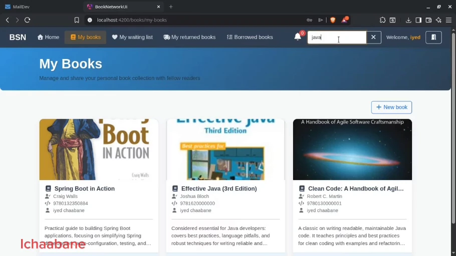
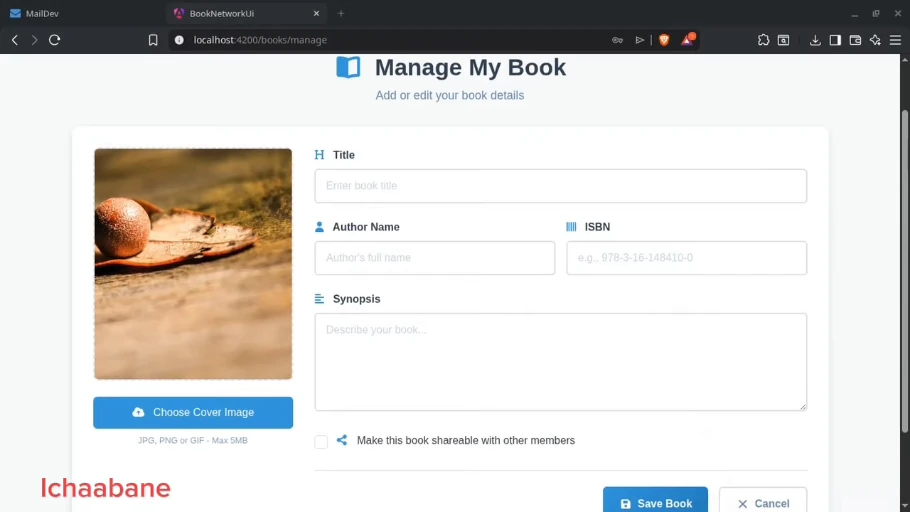
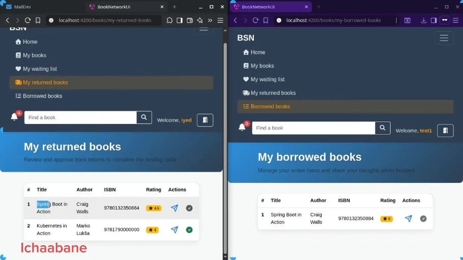
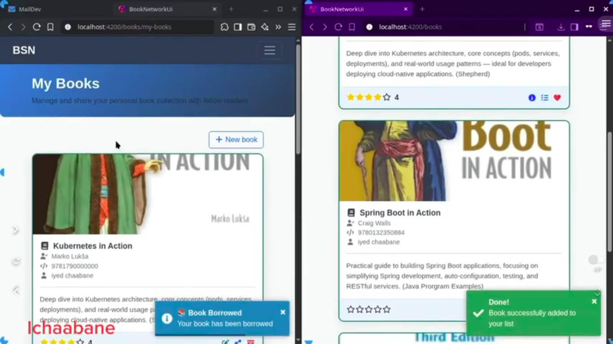

# Book Social Network

A full-stack social network application for book lovers, built with Spring Boot (Backend) and Angular (Frontend).

## 📸 Application Screenshots

The screenshots below illustrate the book-sharing workflows. Image files are prepared for `docs/images/` and must be uploaded to this branch before merging the pull request.

| Book Catalog | Book Management |
|:---:|:---:|
|  |  |

| Borrowing & Returns | Book Borrowing |
|:---:|:---:|
|  |  |

### Ratings & Feedback


## 🎬 Video Demonstration

Watch the Book Social Network application walkthrough on YouTube.

[](https://www.youtube.com/watch?v=XEUTdd2zWk8)

▶️ [Watch the full video demonstration](https://www.youtube.com/watch?v=XEUTdd2zWk8)

## Project Structure

- **[book-network](./book-network)**: The backend API built with Java 17 and Spring Boot 3.
- **[book-network-ui](./book-network-ui)**: The frontend user interface built with Angular 17.
- **[docker-compose.yml](./docker-compose.yml)**: Docker configuration for required services (PostgreSQL, MailDev).

## Prerequisites

- **Java Development Kit (JDK) 17** or higher
- **Node.js** (LTS version recommended) & **NPM**
- **Docker** & **Docker Compose**
- **Maven** (optional, wrapper included)

## Getting Started

1.  **Start Infrastructure**:
    Run the following command to start PostgreSQL and MailDev:
    ```bash
    docker-compose up -d
    ```

2.  **Start Backend**:
    Navigate to the `book-network` directory and follow the [Backend README](./book-network/README.md).

3.  **Start Frontend**:
    Navigate to the `book-network-ui` directory and follow the [Frontend README](./book-network-ui/README.md).

## Services

- **App**: `http://localhost:4200`
- **API**: `http://localhost:8088/api/v1` (Default)
- **MailDev**: `http://localhost:1080`
- **Database**: PostgreSQL on port `5432`
